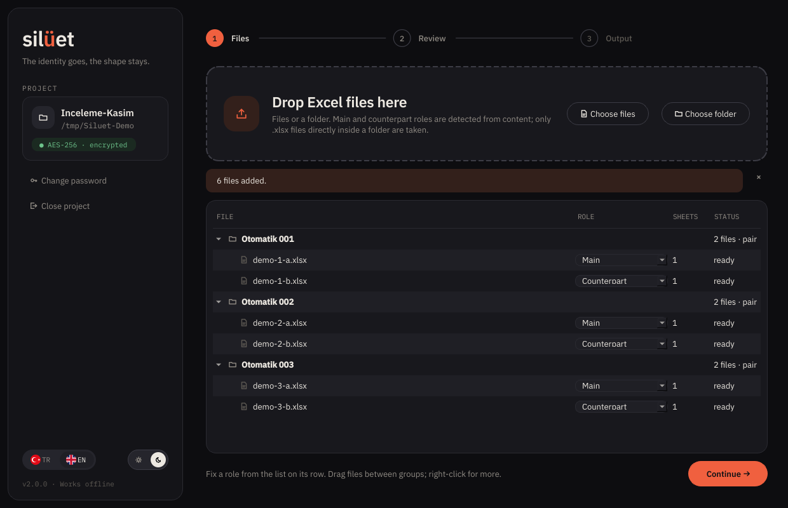
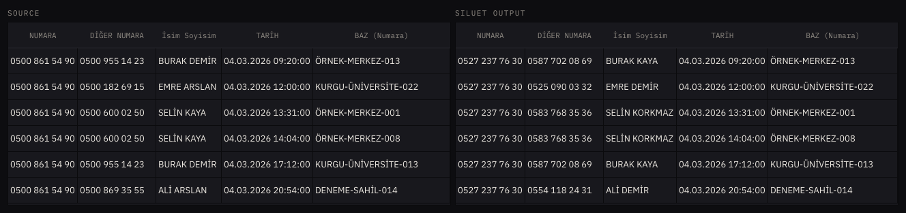
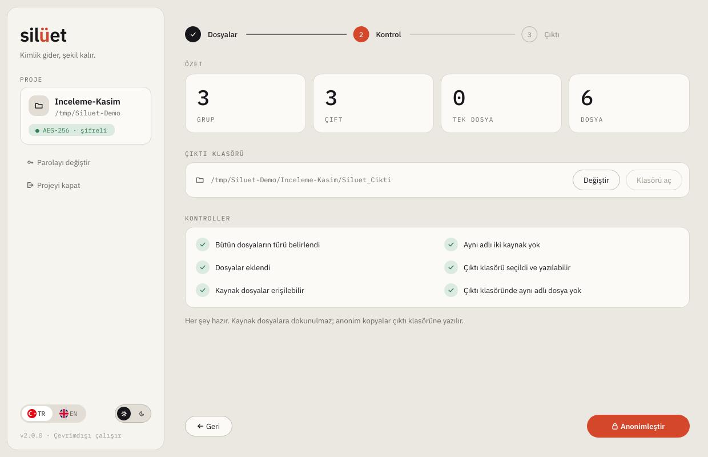

<p align="center"></p>

<h1 align="center">silüet</h1>
<p align="center"><b>The identity goes, the shape stays.</b><br>
An offline desktop tool that anonymizes Turkish telecom (HTS) Excel records while keeping their structure, formatting and the links between paired files.</p>

<p align="center">
<a href="#english">English</a> · <a href="#türkçe">Türkçe</a> · <a href="../../releases/latest">Download</a>
</p>

<p align="center"></p>

---

## English

### What it does

HTS records are call-detail Excel reports produced by Turkish operators. Investigators and analysts often need to share them for training, review or tooling work without exposing the people in them. Blanking the sensitive columns destroys what makes the data useful: who called whom, from where and when.

Silüet replaces identities, not structure:

| Kept as-is | Replaced consistently |
|---|---|
| Sheet layout, merged cells, column widths, styles, formulas, row order | Phone numbers (all digits except country/trunk prefix and number class) |
| Dates, durations, call types, record numbers, status columns | National ID numbers (always with an invalid checksum, so they can never be a real person's) |
| Base station (BAZ) information and first names | Surnames, addresses, birth data, parents' names |
| | IMEI / IMSI / ICCID, IP / MAC, institution and file numbers |

The same real value always maps to the same fake value inside a group, so a number that appears in a main record and its counterpart record still matches after anonymization. `0532…`, `90532…` and `+90 532…` are recognized as one subscriber.

<p align="center"></p>

### How it works

1. **Files.** Drop Excel files or a folder. Main and counterpart records are paired by content, not by file name. Files whose role is unclear wait for you to pick one.
2. **Review.** Silüet checks that every role is set, every source is reachable, no two sources share a name and the output folder is writable and free of name clashes.
3. **Output.** Anonymized copies are written to a separate folder. Partial output is removed if you cancel. Sources are never modified, and their SHA-256 hashes are checked to prove it.

### Security model

- **Keyed pseudonyms.** Replacements come from HMAC-SHA256 with a random 32-byte key per project, so the mapping cannot be recomputed without the key.
- **Encrypted project file.** The key, the mappings, the file paths and the group names are stored in `hts-projesi.json`, encrypted with your password: scrypt (n = 2¹⁷, r = 8, p = 1) and AES-256-GCM, with the header bound as associated data. The password is never stored.
- **No leaks by design.** Comments, document properties and hyperlink targets are stripped from outputs. Error messages and logs never contain cell values, and long digit runs are masked in the crash log.
- **One window per project.** An OS-level file lock prevents opening the same project twice, and it is released automatically if the app crashes.

See [SECURITY.md](SECURITY.md) for what Silüet does and does not protect against.

### Download

Get the latest build from [Releases](../../releases/latest):

- **Windows 10/11:** `Siluet-windows.zip`. Extract it and run `Siluet.exe`; nothing to install.
- **Linux (x86-64):** `Siluet-linux.tar.gz`. Extract it and run `./Siluet`; `./kur.sh` adds it to your application menu. Tested on X11 and Wayland.

The interface is available in Turkish and English, with light and dark themes.

### Build from source

```bash
python -m pip install -r requirements.txt
python -m siluet.ui.app                     # run
QT_QPA_PLATFORM=offscreen pytest -q         # tests
bash build_linux.sh                         # Linux package
powershell -File build_windows.ps1          # Windows package
```

Requires Python 3.10+, PySide6, openpyxl and cryptography. Every push is built and smoke-tested on Windows and Linux by GitHub Actions; tagged versions are published to Releases.

### Limitations

- Only `.xlsx` is supported.
- First names and base station names are kept on purpose, because analysis depends on them. Review whether that fits your use case.
- This is a pseudonymization tool, not a legal compliance assessment.

---

## Türkçe

### Ne yapar

HTS kayıtları, operatörlerin ürettiği arama ve iletişim dökümü Excel raporlarıdır. Eğitim, inceleme ya da araç geliştirme için paylaşılmaları gerekir; ama içindeki kişiler açığa çıkmamalıdır. Hassas sütunları silmek ise veriyi işe yaramaz hâle getirir: kimin kimi, nereden ve ne zaman aradığı kaybolur.

Silüet kimliği değiştirir, yapıyı korur:

| Aynen korunur | Tutarlı biçimde değiştirilir |
|---|---|
| Sayfa düzeni, birleşik hücreler, sütun genişlikleri, biçimler, formüller, satır sırası | Telefon numaraları (ülke/trunk öneki ve numara türü hanesi dışındaki bütün haneler) |
| Tarihler, süreler, iletişim tipleri, sıra numaraları, durum sütunları | T.C. kimlik numaraları (kontrol hanesi her zaman geçersiz; gerçek bir kişiye ait olamaz) |
| BAZ bilgisi ve adlar | Soyadlar, adresler, doğum bilgileri, anne/baba adları |
| | IMEI / IMSI / ICCID, IP / MAC, kurum ve dosya numaraları |

Aynı gerçek değer, grup içinde her zaman aynı sahte değere dönüşür. Ana bazda ve karşı bazda geçen bir numara, anonimleştirmeden sonra da eşleşmeye devam eder. `0532…`, `90532…` ve `+90 532…` aynı abone olarak tanınır.

<p align="center"></p>

### Nasıl çalışır

1. **Dosyalar.** Excel dosyalarını ya da klasörü bırakın. Ana ve karşı baz dosya adından değil içerikten eşleşir. Türü belirsiz dosyalar sizin seçmenizi bekler.
2. **Kontrol.** Silüet şunları denetler: her dosyanın türü belirlenmiş mi, kaynaklara erişilebiliyor mu, aynı adlı iki kaynak var mı, çıktı klasörü yazılabilir ve çakışmasız mı.
3. **Çıktı.** Anonim kopyalar ayrı bir klasöre yazılır. İptal ederseniz yarım kalan çıktı silinir. Kaynak dosyalara dokunulmaz; bu, SHA-256 özetleriyle doğrulanır.

### Güvenlik modeli

- **Anahtarlı takma adlar.** Değerler, her proje için rastgele üretilen 32 baytlık anahtarla HMAC-SHA256'dan türetilir. Anahtar olmadan eşleme yeniden hesaplanamaz.
- **Şifreli proje dosyası.** Anahtar, eşlemeler, dosya yolları ve grup adları `hts-projesi.json` içinde parolanızla şifrelenir: scrypt (n = 2¹⁷, r = 8, p = 1) ve AES-256-GCM, başlık ek veri olarak bağlı. Parola hiçbir yerde saklanmaz.
- **Tasarımdan gelen sızıntı koruması.** Yorumlar, belge özellikleri ve bağlantı hedefleri çıktıdan kaldırılır. Hata mesajları ve günlükler hücre değeri içermez; çökme günlüğünde uzun rakam dizileri maskelenir.
- **Proje başına tek pencere.** İşletim sistemi düzeyindeki dosya kilidi aynı projenin iki kez açılmasını engeller; uygulama çökerse kilit kendiliğinden bırakılır.

Silüet'in neye karşı koruduğu ve neye karşı korumadığı [SECURITY.md](SECURITY.md) dosyasında yazar.

### İndirme

Son sürüm [Releases](../../releases/latest) sayfasında:

- **Windows 10/11:** `Siluet-windows.zip`. Çıkarın ve `Siluet.exe` dosyasını çalıştırın; kurulum gerekmez.
- **Linux (x86-64):** `Siluet-linux.tar.gz`. Çıkarın ve `./Siluet` ile çalıştırın; `./kur.sh` uygulama menüsüne ekler. X11 ve Wayland üzerinde denendi.

Arayüz Türkçe ve İngilizce, açık ve koyu temalıdır.

### Sınırlar

- Yalnız `.xlsx` desteklenir.
- Adlar ve BAZ adları, analiz bunlara dayandığı için bilerek korunur. Kullanım amacınıza uygun olup olmadığını değerlendirin.
- Bu bir takma adlandırma aracıdır; hukuki uygunluk değerlendirmesinin yerini tutmaz.

---

Made by **Yusuf Tuncel** ([@yetece1](https://github.com/yetece1)).

[MIT License](LICENSE) · Fonts: IBM Plex (SIL Open Font License 1.1)
